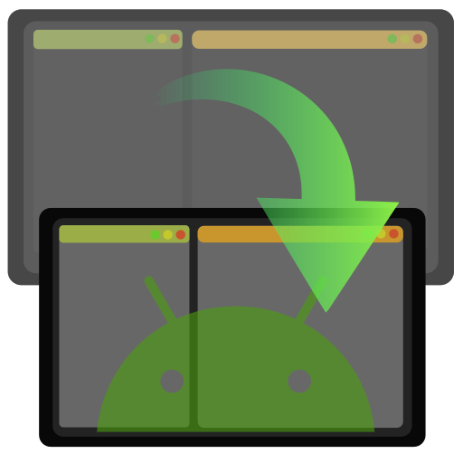
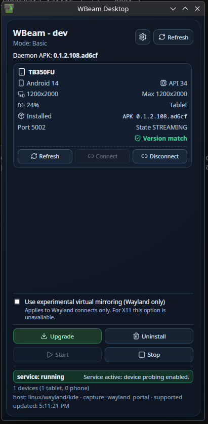

<p align="center">
  <a href="docs/assets/wbeam.svg"></a>
</p>

<h1 align="center">WayBeam</h1>

<p align="center"><strong>A Linux display on your Android device, over USB.</strong></p>

<p align="center">
  <a href="#quick-start">Quick start</a> ·
  <a href="docs/README.md">Documentation</a> ·
  <a href="docs/repo-structure.md">Architecture</a> ·
  <a href="docs/agents.workflow.md">Development</a> ·
  <a href="https://github.com/ppotepa/WBeam/releases">Releases</a>
</p>

WayBeam captures an EVDI virtual display or a Wayland ScreenCast source, encodes
H.264/H.265 where supported, and streams to an Android decoder. The Rust daemon
owns capture and sessions; the Tauri desktop app handles setup and controls.
The standard USB path uses `adb reverse`, so it needs no Wi-Fi configuration.

**Status:** source development. Fedora 43 and Ubuntu 24.04 with GNOME Wayland
are release acceptance targets, not a claim of hardware certification. See the
[release checklist](docs/release-checklist.md) for the evidence required before
publication.

The application is now **WayBeam**. Existing package IDs, settings and service
names remain compatible; see [branding and upgrades](docs/BRANDING.md).

## Quick start

For this quick start, use a Linux Wayland session, a data-capable USB cable, and an Android device
with USB debugging enabled. **Android 5.0 / API 21+ is needed for the standard
`adb reverse` path.** The app's configured minimum is API 17; older devices need
a separately configured direct/tethered connection. See [Android setup](android/README.md).

```bash
git clone https://github.com/ppotepa/WBeam.git
cd WBeam

./install-waybeam --dry-run
./install-waybeam --backend wayland
./desktop.sh
```

The installer prepares the host, a systemd user service and Android onboarding.
Accept the USB debugging prompt on the device and the ScreenCast permission
dialog on the host. Source builds also require Rust/Cargo, Node/npm, a supported
JDK and the Android SDK; automatic provisioning differs by distribution.
Read the [installer guide](docs/INSTALLER_WIZARD.md) for prerequisites, EVDI
selection and the Debian/Ubuntu limits; use the [Fedora guide](docs/FEDORA_43_SETUP.md)
for its full bootstrap flow.

Already developing from a checkout? `./redeploy-local` rebuilds and deploys the
host, desktop and Android app. It stops the current daemon, replaces its user
service setup and deploys to connected devices; see the
[development workflow](docs/agents.workflow.md).

## Desktop preview

<p align="center">
  <a href="docs/screenshot.png"></a>
</p>

<p align="center"><em>Repository screenshot from an earlier development build; labels and version numbers may differ from the current UI.</em></p>

## Capture paths

| Path | When to use it | Requirements and limits |
| --- | --- | --- |
| **Wayland Portal** (`wayland_portal`) | Capture a source offered by the compositor | ScreenCast portal, PipeWire and user consent; source types depend on the compositor. The installer calls this option `wayland`. |
| **EVDI** (`evdi`) | Create and capture a virtual display | A compatible kernel module and `libevdi`, device permissions and an EVDI-enabled streamer. See the [setup guide](docs/EVDI_SETUP_GUIDE.md) and [compatibility matrix](docs/EVDI_COMPATIBILITY_MATRIX.md). |
| **X11 — legacy** | Retained implementation and historical diagnostics | Remains in the repository. It is outside the current release UI, automatic selection and supported runtime paths. |

Desktop **Auto** selects an available EVDI or Wayland Portal backend. A successful
dependency check does not prove that capture or Android decoding works; confirm
an actual moving image on the device.

## Everyday commands

Run from the repository root:

| Task | Command |
| --- | --- |
| Open the desktop app | `./desktop.sh` |
| Rerun Android onboarding | `./waybeam device setup` |
| Check daemon and device versions | `./waybeam host status` · `./waybeam version doctor` |
| Inspect active streams | `./waybeam watch streaming --once` |
| Check EVDI prerequisites | `./waybeam deps virtual check --json` |
| Tune encoding profiles | `./waybeam host tuner` |
| Show all CLI groups | `./waybeam help` |

For a persistent daemon, use `systemctl --user status wbeam-daemon.service`
and `journalctl --user -u wbeam-daemon.service`. `./waybeam host run` is a separate
foreground mode. Configuration and log locations are in the
[repository guide](docs/repo-structure.md).

## Troubleshooting

| Symptom | First check |
| --- | --- |
| Device missing or unauthorized | Run `adb devices`; unlock the device and accept USB debugging. |
| Connected, but no image | Check `./waybeam host status`, `./waybeam version doctor` and `./waybeam watch streaming --once`; confirm Portal consent or EVDI readiness. |
| EVDI does not start | Run `bash scripts/evdi-diagnose.sh --verbose`; follow the [EVDI guide](docs/EVDI_SETUP_GUIDE.md). |
| Encoder or desktop dependencies missing | Follow the distribution prerequisites in the [installer guide](docs/INSTALLER_WIZARD.md) or [Fedora guide](docs/FEDORA_43_SETUP.md). |

The control API and video TCP listener both default to loopback (`127.0.0.1`),
on ports `5001` and `5000`. Direct/LAN access needs explicit opt-in for each
listener. Read the
[security and network model](docs/SECURITY_RELEASE.md) before using a direct/LAN
connection or changing bind settings.

## Documentation and licensing

The [documentation index](docs/README.md) covers setup, architecture, the live
wire/telemetry contract, testing, signing and release acceptance.

Cargo and RPM metadata declare MIT, but the repository has no root `LICENSE`
file. Publication requires the owner to confirm the terms and add that file;
packaging metadata alone is not a license grant.
