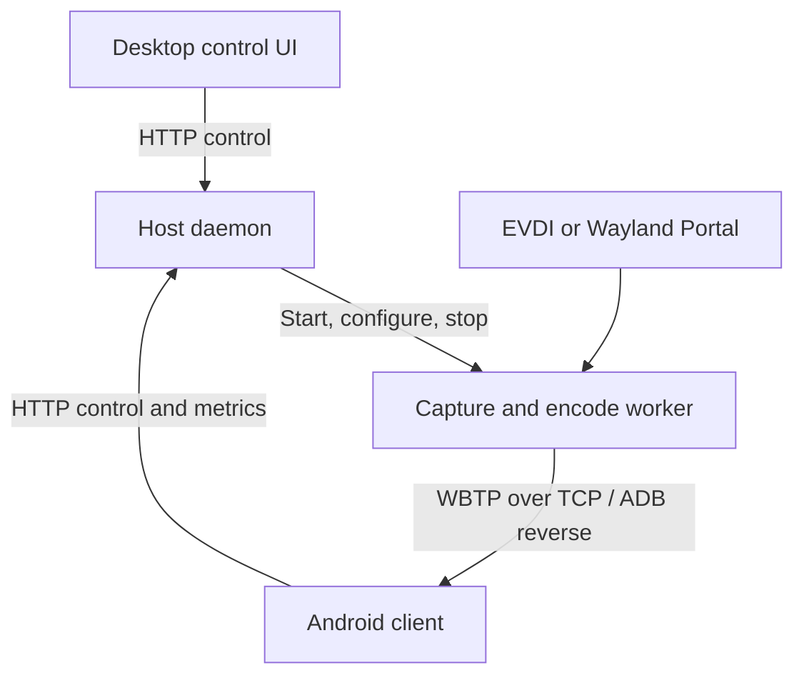

# Architecture and Repository Map

WBeam runs a Linux control daemon, a capture/encode worker, an Android receiver,
and a desktop control client. The daemon owns session state; clients send intent
and display the state returned by its API.

## Runtime Flow

The control API defaults to `127.0.0.1:5001`; the base stream port is `5000`.
The session registry assigns separate stream ports to multiple devices. ADB
reverse lets Android connect through its own loopback address. Older devices
without reverse support need a reachable host address; see the
[Android guide](../android/README.md). The stream listener currently binds all
IPv4 interfaces. See [network exposure and trust](SECURITY_RELEASE.md) before
using a direct LAN or tethered connection.

Release capture paths are EVDI and Wayland Portal. X11 capture and display
helpers remain in the tree as a **legacy path**, but the current release resolver
rejects X11 capture and does not select it as an automatic fallback.

## Repository Map

| Path | Responsibility |
|---|---|
| [`wbeam`](../wbeam) | Main CLI: host, Android, diagnostics, version checks |
| [`install-wbeam`](../install-wbeam) | Fresh-machine source installer |
| [`redeploy-local`](../redeploy-local) | Developer rebuild, Android deploy, desktop launch |
| [`desktop.sh`](../desktop.sh), [`devtool`](../devtool), [`wbgui`](../wbgui) | Desktop launcher and developer menus |
| [`start-remote`](../start-remote), [`runas-remote`](../runas-remote) | Bootstrap or run commands in another desktop session |
| [`host/`](../host/README.md) | Daemon, streamer, tuner, runtime shell helpers |
| [`android/`](../android/README.md) | Android app, decoder, HUD and client telemetry |
| [`desktop/`](../desktop/README.md) | Tauri desktop client |
| [`shared/protocol/`](../shared/README.md) | WBTP Rust framing and protocol test tools |
| [`config/`](../config/) | User-config bootstrap template and example tuning profiles |
| [`scripts/`](../scripts/) | Installation, diagnostics, packaging and CI helpers |
| [`e2e/`](../e2e/README.md) | VM scenarios and acceptance automation |
| [`docs/`](README.md) | Setup guides, contracts and release evidence requirements |

Source runs write CLI/desktop logs under `logs/`, daemon logs under
`host/rust/logs/`, and resolved configuration under `logs/effective-runtime/`.
Installed-mode logs/snapshots default to
`${XDG_STATE_HOME:-$HOME/.local/state}/wbeam/logs/`. These are runtime files,
not repository content. Launcher output and the service journal identify the
active location; explicit log-directory overrides take precedence.

## Host Workspace

[`host/rust/Cargo.toml`](../host/rust/Cargo.toml) contains five crates:

| Crate | Role |
|---|---|
| `wbeamd-api` | HTTP request/response models, presets and validation |
| `wbeamd-core` | Session lifecycle, adaptation, configuration and process supervision |
| `wbeamd-server` | Axum HTTP routes, per-device session registry and display coordination |
| `wbeamd-streamer` | Capture → GStreamer encode → WBTP framing → TCP transport |
| `wbeamd-tuner` | Interactive Rust TUI autotuner, launched by `./wbeam host tuner` |

Use `GET /v1/health` for daemon health, `/v1/host-probe` for capture availability,
and `/v1/status` for session state. `/v1/start`, `/v1/stop` and `/v1/apply` control
the session. Requests can select a device with `serial` and `stream_port` query
parameters. The [router](../host/rust/crates/wbeamd-server/src/server/routes.rs)
is the complete endpoint list; [API models](../host/rust/crates/wbeamd-api/src/lib.rs)
define payloads. The [telemetry contract](telemetry_schema.md) documents metrics
and the stream format.

## Android and Desktop

The Android Gradle module is `:app`, with application ID `com.wbeam` by default.
Its `stream/`, `api/`, `telemetry/`, `hud/`, `startup/` and `ui/` packages separate
decode, host communication, metrics and on-device presentation. The configured
minimum API and deploy-time `legacy`/`modern` selection are explained in the
[Android guide](../android/README.md); they do not certify every device or codec.

The desktop implementation is one Tauri 2 app at
[`desktop/apps/desktop-tauri`](../desktop/apps/desktop-tauri/README.md), using
SolidJS/TypeScript and a Rust bridge for host API calls, ADB and service control.
Profile tuning is provided by the host TUI; there is no separate trainer desktop
application in this checkout.

## Configuration and Boundaries

The shell entrypoints bootstrap a missing user configuration from
[`config/wbeam.conf`](../config/wbeam.conf). Existing environment variables win
over `$XDG_CONFIG_HOME/wbeam/wbeam.conf` (default
`~/.config/wbeam/wbeam.conf`). Editing the repository template does not replace
an existing user configuration. The
[config loader](../host/scripts/wbeam_config.sh) defines the exact behavior.

- **Host** owns stream lifecycle, runtime decisions and authoritative state.
- **Android** owns receive/decode/render behavior and on-device UX.
- **Desktop** coordinates user actions and renders host state.
- **Shared** keeps wire framing and reusable protocol tools independent of UI
  and host policy. HTTP API models currently live in `wbeamd-api`.

See the [development workflow](agents.workflow.md) for builds and validation.
